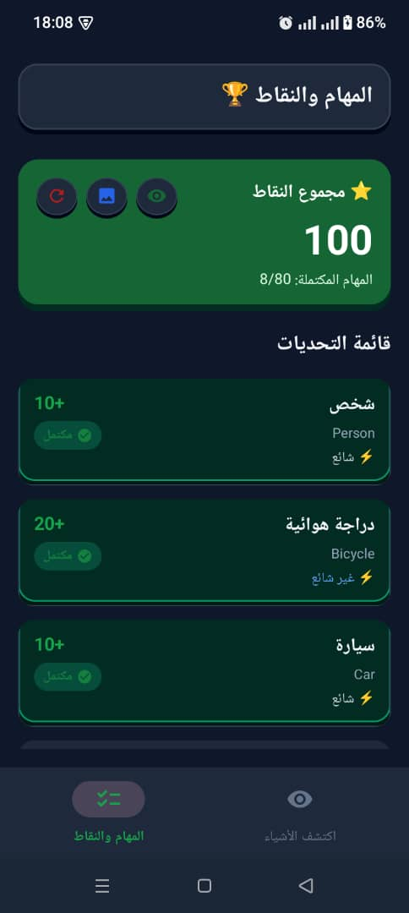
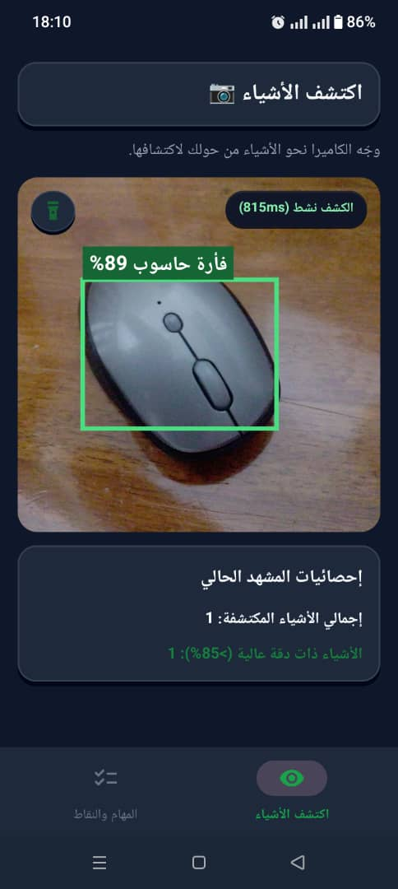

# Vision Hunt

**Vision Hunt** is an interactive, fully offline Android scavenger hunt game powered by on-device Artificial Intelligence. The game encourages players to explore their real-world environment to find specific objects, detecting them in real-time using the smartphone's camera.

---

## How the Game Works

The core mechanics of Vision Hunt are simple yet engaging:
1. **The Challenge List**: Players start by viewing a list of tasks (objects to find) grouped by rarity (Common, Uncommon, Rare) and point values.
2. **Real-time Discovery**: Players navigate to the "Camera" tab and point their device at real-world objects.
3. **AI Detection**: The app analyzes the camera feed in real-time. If it detects one of the target objects with a high confidence score (greater than 85%), it automatically registers a "hit".
4. **Scoring & Saving**: When an object is successfully detected, the player is awarded points. The game captures a snapshot of the object and saves it locally in the device's database to prevent cheating.
5. **Offline Progress**: All points, completed tasks, and images are saved on the local SQLite database. No internet connection is required.

### Screenshots

| Tasks & Points | Camera Detection |
| :---: | :---: |
|  |  |

---

## Project Structure

The project follows a clean architecture pattern utilizing Android's modern MVVM (Model-View-ViewModel) architecture.

```
com.example.visionhunt
│
├── data/                  # Data layer (Local DB, Repositories, Game Data)
│   ├── CapturedItemDbHelper.kt   # SQLite Database for captured images/history
│   ├── CocoTasks.kt              # Definitions of game tasks mapped to COCO dataset
│   └── GameRepository.kt         # Manages local SharedPreferences for score/progress
│
├── detector/              # AI and Machine Learning layer
│   └── ObjectDetectorHelper.kt   # TensorFlow Lite setup and inference logic
│
├── model/                 # Domain data classes
│   ├── CapturedItem.kt           # Entity for saved images
│   └── GameModels.kt             # Game state, rarity, and detection models
│
├── ui/                    # Presentation layer
│   ├── adapters/                 # RecyclerView adapters (Tasks list, Captured Images)
│   ├── components/               # Reusable UI components
│   ├── fragments/                # Main screens (TasksFragment, CameraFragment)
│   ├── screens/                  # Independent activities (MainActivity, CapturedImagesActivity)
│   ├── viewmodel/                # ViewModels (GameViewModel)
│   └── views/                    # Custom Views (DetectionOverlayView for bounding boxes)
│
└── util/                  # Utilities (Toast helpers, Extensions)
```

---

## AI Integration: EfficientDet-Lite3

Vision Hunt utilizes **EfficientDet-Lite3**, a state-of-the-art object detection model optimized for mobile and edge devices. It offers an excellent balance between latency (speed) and accuracy.

### How it is Used in the Project:

1. **On-Device Edge AI**: 
   The model file (efficientdet_lite3.tflite) is bundled directly in the app's assets/models/ folder. This guarantees 100% offline inference with zero server communication, ensuring privacy and instant feedback.

2. **TensorFlow Lite Task Vision Library**:
   The app uses the org.tensorflow.lite.task.vision library to load the model and process camera frames. 

3. **Inference Pipeline (ObjectDetectorHelper.kt)**:
   * **Input**: The CameraX API streams ImageProxy frames.
   * **Processing**: The frames are converted to Bitmaps and fed into the ObjectDetector.
   * **Output**: The model returns a list of detected objects, containing the class label (e.g., "cup", "laptop"), confidence score (0.0 to 1.0), and a bounding box (RectF).

4. **Localization & Mapping (CocoTasks.kt)**:
   EfficientDet-Lite3 is trained on the COCO (Common Objects in Context) dataset, which outputs labels in English. The CocoTasks object acts as a dictionary, mapping these raw English labels to translated Arabic names, assigned rarities, and point values for the game.

5. **UI Rendering (DetectionOverlayView.kt)**:
   Detected objects are drawn on top of the camera preview. The app dynamically fetches the Arabic translation of the detected object and draws a bounding box alongside the Arabic name and confidence percentage.

6. **Game Logic (GameViewModel.kt)**:
   The ViewModel observes the stream of detections. If a detection matches an uncompleted task and the confidence score exceeds the threshold (85%), the ViewModel triggers a success event, saves the frame, updates the SQLite database, and increments the user's score.